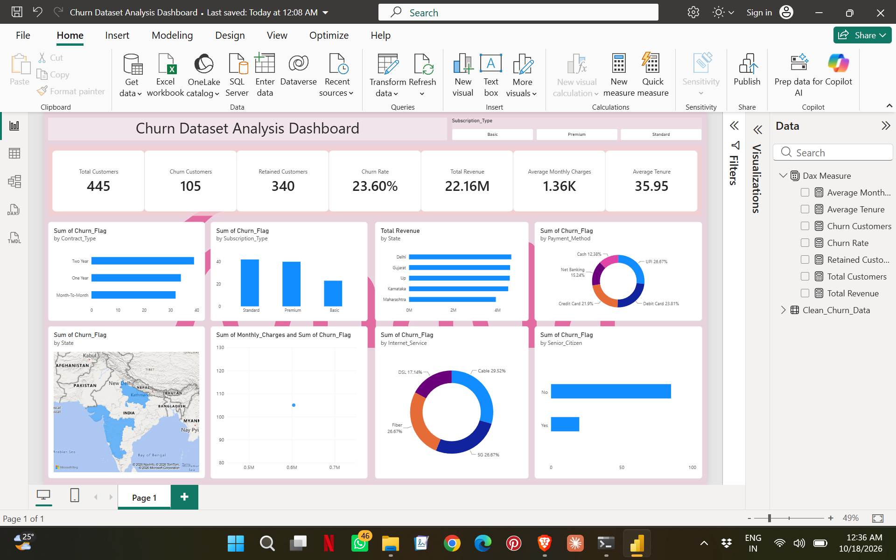

# 📊 Customer Churn Analysis | Python, MySQL & Power BI

**An end-to-end data analytics project exploring customer churn, retention, subscription patterns, and revenue.**

## 🧭 Project Overview

This project demonstrates an end-to-end data analytics workflow, starting with raw customer data, cleaning and transforming it using Python, analyzing it with MySQL, and building an interactive Power BI dashboard to explore customer behavior and churn patterns.

## 🎯 Business Objective

To analyze customer churn and explore how it relates to contract types, subscription plans, internet services, payment methods, customer tenure, and geographic distribution.

The goal is to organize raw data into meaningful insights that can support customer retention analysis and data-driven decision-making.

## 🛠️ Tools & Technologies

- 🐍 **Python:** Pandas, NumPy
- 📓 **Environment:** Jupyter Notebook
- 🗄️ **Database:** MySQL
- 💻 **Query Language:** SQL
- 📊 **Data Visualization:** Microsoft Power BI
- 🧮 **Analytics:** DAX measures, KPI cards, and interactive slicers

## 🔄 Project Workflow

### 1️⃣ Data Exploration
- Inspected the raw dataset, data types, missing values, and duplicate records.
- Examined the dataset structure to identify data quality issues.

### 2️⃣ Data Cleaning & Transformation
- Standardized inconsistent text values and formatting.
- Converted numeric columns and dates to appropriate data types.
- Handled missing values and checked for invalid records.
- Prepared a structured dataset for further analysis.

### 3️⃣ Feature Engineering
Created additional analytical fields to support segmentation and reporting, including:
- Customer Value
- Monthly Revenue
- Tenure Groups
- Senior Customer Flag
- Numerical Churn Flag

### 4️⃣ SQL Analysis with MySQL
Used SQL queries to explore:
- Total customers and churned customers
- Customer churn rate
- Average monthly charges and customer tenure
- Customer distribution by contract and subscription type
- Revenue distribution by state
- Payment methods and internet service
- High-value customer segments

### 5️⃣ Power BI Dashboard
Built an interactive dashboard featuring:
- KPI cards for customers, churn, retention, revenue, and average metrics
- DAX measures for key performance indicators
- Bar charts, column charts, donut charts, and a scatter plot
- Geographic analysis and customer segmentation
- Interactive filters for exploring different customer groups

## 📌 Key Analysis Areas

- 👥 Customer Churn & Retention
- 📃 Contract & Subscription Analysis
- 🌐 Internet Service Distribution
- 💳 Payment Method Analysis
- 🗺️ Geographic Revenue Distribution
- ⏳ Customer Tenure & Value Segmentation
- 📈 Customer Metrics & KPI Reporting

## 🖼️ Dashboard Preview

The interactive Power BI dashboard provides a consolidated view of customer metrics and churn patterns.



## 📁 Repository Structure

```text
customer-churn-analysis/
│
├── README.md
├── notebooks/
│   └── Churn_Dataset_Cleaning_Sanitized.ipynb
├── sql/
│   └── churn_analysis.sql
└── powerbi/
    ├── Churn Dataset Analysis Dashboard.pbix
    └── dashboard_preview.png
```

## 💡 Business Value

This project demonstrates how data cleaning, SQL analysis, and interactive visualization can be combined to explore customer behavior and identify segments that may warrant further investigation.

It highlights the importance of data quality, analytical thinking, and communicating findings through business-focused dashboards.

## 👩‍💻 About Me

**Bhavya Verma**  
Aspiring Data Analyst | Python | SQL | Power BI | Excel

I'm building my data analytics portfolio through hands-on projects that combine data preparation, querying, analysis, and visualization.

🔗 **GitHub:** [Explore my repositories](https://github.com/Rumi004)

